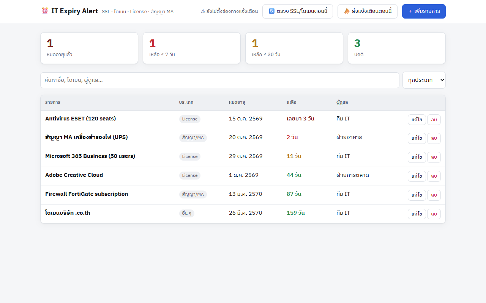
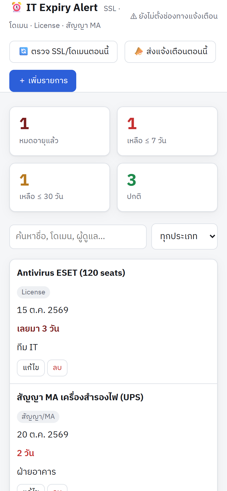

<div align="center">


<br>

    

</div>

<table>
<tr>
<td width="72%"></td>
<td width="28%"></td>
</tr>
<tr><td align="center"><sub>คอมพิวเตอร์ (ข้อมูลตัวอย่าง)</sub></td><td align="center"><sub>มือถือ</sub></td></tr>
</table>

ระบบเตือนก่อนของ IT หมดอายุ ครอบคลุม SSL certificate, โดเมน, license ซอฟต์แวร์ และสัญญา MA
ถ้าปล่อยให้ของพวกนี้หมดอายุ ระบบจะล่มทันที แต่ส่วนใหญ่ยังจดกันใน Excel หรือจำเอา

## ความสามารถ
- **ตรวจ SSL อัตโนมัติ**: ต่อไปที่เว็บจริงแล้วอ่านวันหมดอายุจากใบรับรอง
- **ตรวจโดเมนอัตโนมัติ** ผ่าน RDAP (โดเมน .th ไม่มีข้อมูล RDAP ต้องใส่วันเอง)
- **License / สัญญา MA / อื่น ๆ**: ใส่วันหมดอายุเอง
- **แจ้งเตือนทุกเช้า 08:00 น.** (Vercel Cron) ผ่าน Discord, Slack, Google Chat, LINE หรือ Telegram
- แจ้งเป็นช่วงเมื่อเหลือ 60 / 30 / 14 / 7 / 3 / 1 / 0 วัน ช่วงละครั้ง ไม่สแปมทุกวัน
  พอต่ออายุแล้ว (วันหมดอายุเปลี่ยน) รอบแจ้งเตือนจะเริ่มนับใหม่เอง
- แจ้งเมื่อตรวจอัตโนมัติไม่สำเร็จ เช่นเว็บล่มหรือต่อไม่ได้

## รันในเครื่อง
```bash
npm install
cp .env.example .env   # แก้ค่าตามต้องการ ถ้ายังไม่ใส่อะไรก็รันได้
npm run dev            # http://localhost:3000
```
ถ้าไม่ได้ตั้งค่า Redis ข้อมูลจะเก็บเป็นไฟล์ในโฟลเดอร์ `.data/`

## Deploy ขึ้น Vercel
1. Push ขึ้น GitHub แล้ว Import เข้า Vercel
2. Storage → เพิ่ม **Upstash Redis** (ฟรี) แล้ว env `KV_REST_API_*` จะมาเอง
3. ตั้ง `ADMIN_KEY` และช่องทางแจ้งเตือนอย่างน้อย 1 ช่องทาง
4. Cron อยู่ใน `vercel.json` แล้ว (`0 1 * * *` UTC = 08:00 น. เวลาไทย)

---

<div align="center"><sub>ชุดเครื่องมือ IT เดียวกัน: [🛠️ IT Runbook](https://github.com/tanakrthum254614-max/it-runbook) · [💻 IT Asset Tracker](https://github.com/tanakrthum254614-max/it-asset-tracker) · โดย <a href="https://github.com/tanakrthum254614-max">tanakrthum254614-max</a> 🇹🇭</sub></div>
